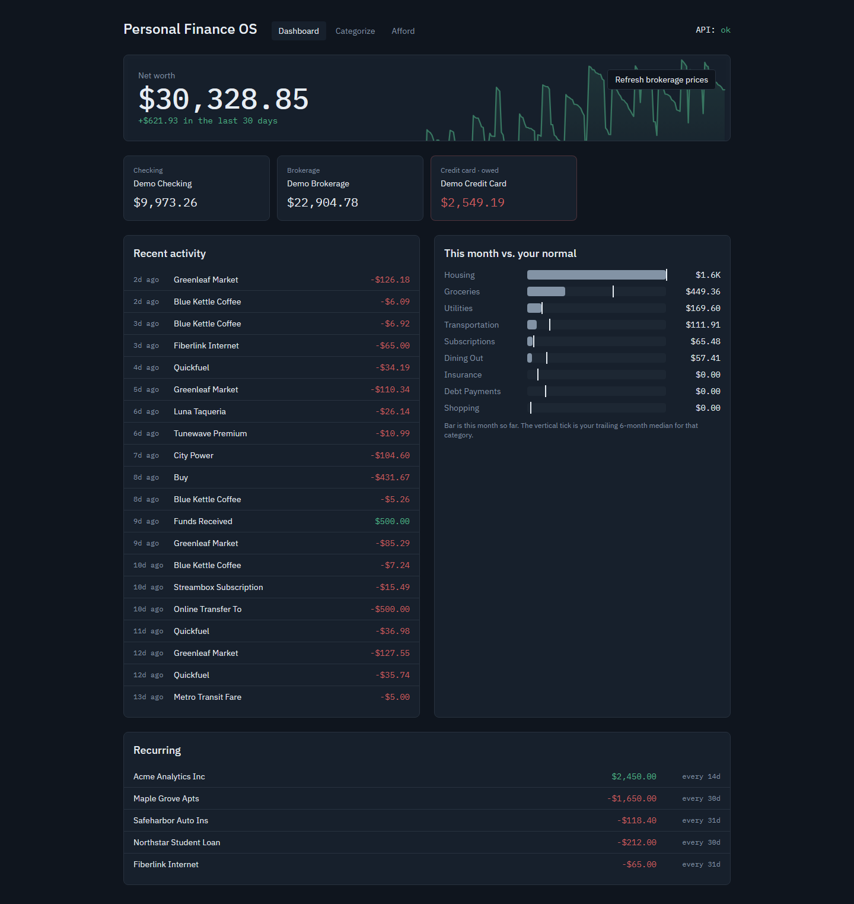
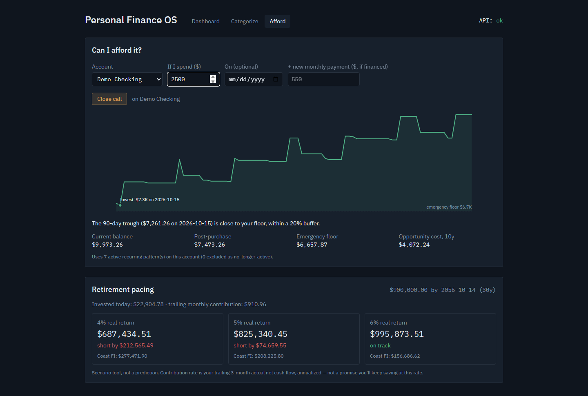
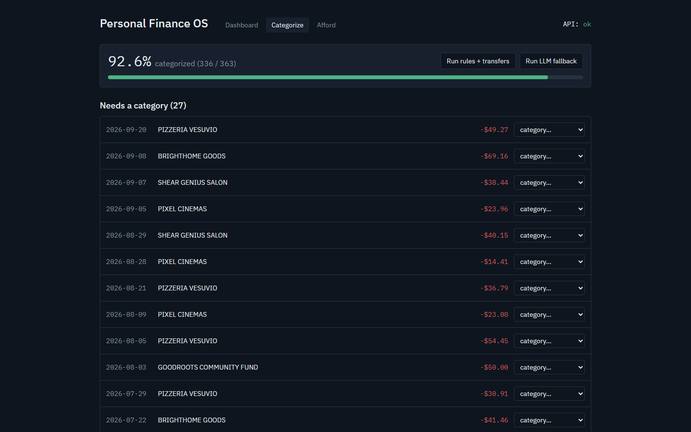

# personal-finance-app

A local-only personal finance dashboard built around one question: **can I afford this?** Type in a purchase and it projects your checking balance 90 days forward from your actual recurring bills and paychecks, finds the lowest point, and gives a green / yellow / red verdict with the numbers that produced it.

Everything runs on your machine: FastAPI + SQLite on `127.0.0.1`, a React dashboard, and a local Ollama model for the categorization it can't do with rules. Bank data comes in as CSV exports, mapped per institution with a small YAML file.

This repo ships with a **synthetic demo dataset** (fake bank, fake card, fake brokerage, about six months of fake transactions) so you can run it in one command without any real data.

---

## Demo

**Dashboard:** net worth with a 12-month trend, account balances, recent activity, this month's spending against your trailing 6-month median, and detected recurring bills.



**Afford:** "If I spend $2,500 from checking today?" A *close call*: the post-purchase balance is fine, but the 90-day trough lands within 20% of the emergency floor. Below that, retirement pacing under 4% / 5% / 6% real returns.



**Categorize:** what the rules didn't catch, waiting for a manual pick (which becomes a rule) or the local LLM fallback.



---

## Features

**CSV import with per-institution YAML mappings.** Every bank formats its export differently. A mapping file declares the date column and format, the description column, and how amounts work: one signed column, a column with the sign inverted (card issuers love this), or separate withdrawal/deposit columns. Every importer normalizes to a single sign convention at the boundary (outflow negative, inflow positive), so nothing downstream ever re-checks signs.

**Duplicate skipping.** Each transaction gets a content hash of `account | date | amount | description`. Re-downloading a statement that overlaps last month's is the normal case, and the overlap is silently skipped instead of poisoning every average.

**Transfer detection.** Paying the credit card from checking isn't spending; it's the same dollars moving. Opposite-signed, equal-amount transactions on two different accounts within ±3 days are paired and excluded from all spend math. Without this, spending reads 2–3× too high.

**Holdings re-priced from Yahoo Finance.** Brokerage positions (symbol + share count) are re-priced on demand from Yahoo's public chart endpoint, with no API key. Brokerage balance = market value + cash.

**Rule-based categorization with a local LLM fallback.** Merchant names are normalized deterministically (`SQ *BLUE KETTLE COFFEE` → `Blue Kettle Coffee`), then matched against rules. Only what the rules miss goes to a local Ollama model (`llama3.2:3b`) in small batches. Its output is validated against the fixed category list, and it is never allowed to overwrite a deterministic merchant name.

**Corrections become rules.** Picking a category by hand writes a rule keyed on the normalized merchant, so the next import categorizes that merchant automatically. The LLM's workload shrinks every month.

**"Can I afford this?" (90-day check).** Four factors, one verdict:
1. Post-purchase balance vs. an emergency floor (N months of trailing median fixed costs).
2. The 90-day cash trough: recurring patterns on the account projected forward, purchase included.
3. If financed, how a new monthly payment moves your savings rate.
4. Opportunity cost: what the amount compounds to over 10 / 20 / 30 years.

Green if it clears everything, yellow if the trough is within 20% of the floor or savings rate drops ≥ 5 points, red if anything goes below the floor or savings rate goes negative.

**Retirement pacing under three return scenarios.** Projects invested balances plus your trailing actual monthly net cash flow to a target date at 4%, 5%, and 6% *real* returns, never a single number, along with a Coast FI figure for each scenario.

**Also:** recurring-bill detection (≥ 3 occurrences, amount within 10% and gap within 4 days of the median), and net worth history reconstructed day by day by walking each cash account's transactions backward from its latest balance.

---

## Architecture

```
api/                         FastAPI backend (Python)
├── main.py                  31 endpoints; also serves the built web app
├── models.py                SQLModel tables — money is always int cents
├── paths.py                 real vs. demo mode: which DB, statements, config
├── demo.py                  one-command demo: generate → import → serve
├── importers/
│   ├── base.py              importer contract, sign convention, dedup hash, ingest
│   └── csv_import.py        YAML-mapped CSV parser (single / negated / split)
├── engine/
│   ├── transfers.py         cross-account transfer pairing
│   ├── categorize.py        merchant normalization, rules, overrides → rules, LLM batches
│   ├── recurring.py         recurring pattern detection
│   ├── cashflow.py          income / fixed / variable / discretionary, trailing medians
│   ├── projection.py        90-day forward cash projection (the trough)
│   ├── affordability.py     the four-factor verdict
│   ├── retirement.py        three-scenario pacing + Coast FI
│   ├── holdings.py          positions + re-pricing
│   ├── prices.py            Yahoo Finance chart endpoint
│   └── networth.py          daily net worth reconstruction
└── llm/categorizer.py       Ollama client behind a swappable Categorizer protocol
web/src/                     React + TypeScript + Tailwind
├── pages/                   Dashboard, Categorize, Afford
└── components/              trough chart, net worth chart, category bars
demo/                        synthetic data — safe to commit
├── generator.py             deterministic fake statements for 3 fake accounts
├── accounts.yaml, rules.yaml, mappings/
└── statements/              sample output of the generator
config/                      your own accounts + mappings (gitignored)
launcher/tray.py             optional Windows system-tray launcher
tests/                       pytest, demo data only
```

**Data flow for an import:**

1. `parse_csv` reads the export through its YAML mapping and emits `RawTransaction`s in the app's sign convention.
2. `ingest` hashes each row, skips hashes already in the DB, and records an import batch.
3. `detect_transfers` pairs cross-account moves and flags them.
4. Categorization: transfers get the Transfer category directly → merchants are normalized → rules apply → the Ollama fallback handles the remainder.
5. `detect_recurring` refreshes the recurring table that the dashboard and projection rely on.

**Data flow for an afford check:** `check_affordability` → `project_cash_forward` (recurring patterns *on that account*, transfers included, since a card payment really does leave checking) → trough vs. floor → savings-rate effect from the last 3 complete months → verdict + reasons + numbers.

---

## Tech Stack

| Layer | Library / Service |
|-------|------------------|
| API | FastAPI + Uvicorn, bound to `127.0.0.1` |
| Storage | SQLite via SQLModel (SQLAlchemy 2) |
| Import config | PyYAML: one mapping file per institution |
| LLM fallback | Ollama, `llama3.2:3b`, local HTTP |
| Prices | Yahoo Finance public chart endpoint (no key) |
| Frontend | React 19, TypeScript, Vite, Tailwind CSS 4 |
| Charts | Hand-rolled SVG (trough, net worth, category bars) |
| Desktop | pystray tray launcher (Windows, optional) |
| Tests | pytest, 46 tests on synthetic data, ~4s |

24 Python files (~2,900 lines) and 9 TypeScript files (~1,000 lines).

---

## Getting Started

**Prerequisites:** Python 3.11+ and Node 20+. Ollama is optional (only for the LLM categorization button).

```bash
git clone https://github.com/Swaz5/personal-finance-app.git
cd personal-finance-app

python -m venv api/.venv
source api/.venv/bin/activate        # Windows: api\.venv\Scripts\activate
pip install -r api/requirements.txt

cd web && npm install && npm run build && cd ..
```

**Run the demo:**

```bash
python api/demo.py
```

That generates six months of synthetic statements (anchored to today), imports them through the real importer, runs transfer detection, rules, and recurring detection, seeds holdings and an emergency floor, and serves the app at **http://127.0.0.1:8000**. The output shows what each stage did:

```
  demo_checking_older.csv      parsed   67  inserted   67  skipped duplicates 0
  demo_checking_recent.csv     parsed   12  inserted    2  skipped duplicates 10
  demo_credit_card.csv         parsed  272  inserted  272  skipped duplicates 0
  demo_brokerage.csv           parsed   22  inserted   22  skipped duplicates 0
  transfer pairs matched: 12
  categorized by rules: 312  (left for you / the LLM fallback: 27)
  recurring patterns: 12
```

Options: `--build-only` (build `data/demo.db` and exit), `--offline` (static demo prices instead of Yahoo Finance), `--port N`. On macOS/Linux, `make demo` does the same thing.

The demo writes only to `data/demo.db`. It never reads or modifies `data/finance.db`.

**Run tests:**

```bash
pip install -r api/requirements-dev.txt
python -m pytest
# 46 passed in ~4s
```

Every test runs against generated demo data in a temp directory, with prices stubbed, so there are no network calls and no real data.

**Using your own data:** copy `config/accounts.example.yaml` to `config/accounts.yaml`, add a mapping for each bank in `config/mappings/` (see `demo/mappings/` for one example of each amount style), drop exports in `data/statements/`, and run `uvicorn main:app --host 127.0.0.1` from `api/`. Imports go through `POST /api/import/csv` (interactive docs at `/docs`). All of those paths are gitignored.

For live-reload development, run the API with `--reload` and `npm run dev` in `web/`. Vite proxies `/api` to port 8000.

---

## Privacy

- **Local-only.** The API binds to `127.0.0.1`. The database is a SQLite file on disk. There is no account, sync, or telemetry.
- **The LLM is local too.** Categorization falls back to Ollama on `127.0.0.1:11434`, so transaction descriptions never leave the machine. (The categorizer is a protocol, so a hosted model could be swapped in, but that's a deliberate privacy tradeoff and isn't done here.)
- **One outbound call:** re-pricing holdings sends ticker symbols (and nothing else) to Yahoo Finance.
- **This repository contains only synthetic data.** Every institution, merchant, amount, and share count in `demo/` is made up by `demo/generator.py`. Real statements, databases, personal config, `.env`, and logs are excluded by `.gitignore`, and the repo was scanned for secrets and personal data before publishing.

---

## What I Learned

**A small local LLM should never own derived data.** The first version let the Ollama fallback write back its own cleaned-up merchant name. Two things went wrong at once: the 3B model echoed an example from the prompt back verbatim for transactions it was unsure about, and it gave slightly different names for the same unchanged description on different calls, with one merchant ending up under 13 spellings. Recurring detection groups by merchant name, so subscriptions silently stopped looking recurring. The fix was a division of labor: a deterministic normalizer owns merchant names, the LLM only picks from a closed list of categories, and its output is validated before anything is written. Rules handle the bulk, and every manual correction becomes a rule, so the model sees less each month.

**Pick one sign convention and enforce it at the boundary.** Banks disagree: one exports a single signed column, a card issuer exports purchases as *positive*, and a checking account splits withdrawals and deposits into two columns. Normalizing all of them inside the importer (outflow negative, inflow positive) and storing liabilities as negative balances means net worth is just a sum, and no downstream code ever special-cases an account type. The `negate` flag in a mapping file exists because of exactly one issuer.

**"Not spending" and "not cash movement" are different things.** Transfers have to be excluded from spending, or a card payment counts the same dollars twice. But for the 90-day projection, that same card payment is very real money leaving checking. The recurring-pattern math ended up as one shared function, called with transfers excluded for the bills list and included for the cash projection.

**Forecasts need a way to forget.** The first projection extrapolated every recurring pattern it had ever seen, including paychecks from a previous job that had stopped long ago, which quietly inflated every future balance. Patterns more than two cycles overdue are now treated as dead.

**Be explicit about what's approximated.** Net worth history is exact for checking and credit (walk backward from today's balance, undoing each day's transactions), but brokerage accounts have no daily history, so they're held flat. The projection can't see a card payment whose amount varies every month. Both limitations are written into the code's docstrings instead of being papered over with made-up data.

**Desktop glue is its own debugging problem.** The tray launcher runs under `pythonw.exe`, which has no console, so a crash looks like "nothing happened." It logs to a file for that reason. On one machine, antivirus behavior monitoring re-executed every `pythonw` launch as a parent/child pair, starting two servers that fought over the port. The fix was to make startup idempotent: check for a healthy server before spawning one.

**Color can't be the only signal.** A palette check showed the red/green verdict colors sit too close together for deuteranopia, so every verdict badge also spells out its meaning ("Looks fine" / "Close call" / "Can't afford it").

**Synthetic data is a test suite waiting to happen.** Building the demo dataset for this public version meant planting known transfers and known duplicates, which turned "it works on my statements" into exact assertions: 12 planted pairs, 12 found, zero false positives. Writing those tests immediately surfaced two bugs that real-data use had never hit: a dashboard button hardcoded to one database ID, and an LLM fallback that crashed if a model ever returned a category name not on the list.

---

## License

MIT. See [LICENSE](LICENSE).
